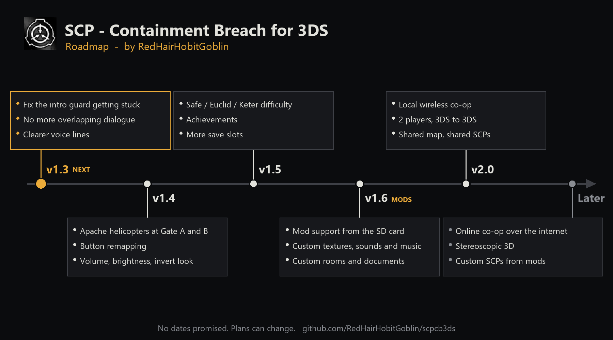

# SCP - Containment Breach for 3DS (unofficial port)

A native Nintendo 3DS port of [SCP - Containment Breach](https://github.com/regalis11/scpcb),
rewritten in C on citro3d, with toned-down visuals for the hardware.

## Status

**Working**

- **Title screen** with the original menu art (logo, tagline and SCP-173) and menu music.
- **Map generation:** a port of `CreateMap()`, covering the three zones, checkpoints, fixed SCP
  rooms and random rooms weighted by `rooms.ini`. The RNG differs from the PC game, so seeds
  don't reproduce PC maps.
- **Rooms:** all 96, with textures, lightmaps and their props, streamed in around the player.
- **Doors:** doors between rooms plus 131 in-room doors from `FillRoom`. Includes standard,
  heavy and big containment doors, keycard slots (levels 1-5 and Omni), hand scanners, keypads
  (touch screen) and locked doors, with the original messages and sounds.
- **Items:** 131 item templates and 117 placed items with their models. A 10-slot inventory on
  the touch screen with the original icons, a document viewer, keycards, first aid kits and
  eyedrops. The S-NAV unlocks the map.
- **Player:** blinking on the original timer (hold R to keep your eyes shut), stamina and
  sprinting, crouching, footsteps, and death and retry.
- **SCP-173:** moves only when unobserved, fast as in the original, through the room grid. It
  opens unlocked doors, drags stone, rattles, plays horror stings, and snaps your neck with the
  original death messages.
- **Intro:** wake up in the Class-D cell, Agent Ulgrin's escort with the original voice lines,
  Dr. Franklin's PA announcements, the breach and blackout in SCP-173's chamber, then on into
  the facility's start room. SKIP INTRO on the title screen goes straight to the facility.
- **SCP-106:** waits for a few minutes, then rises through the floor, stalks you, teleports
  behind you, and sinks away again.
- **SCP-096:** sits crying in a heavy containment room. Look at its face and it gets up, rages,
  then hunts you down at full speed, forcing doors open, with its scream and chase music.
- **SCP-049:** wakes in its room in heavy containment, says its "spotted" and "searching" lines,
  opens doors and follows you.
- **Animated NPCs:** skeletal animation (B3D bones and keyframes, skinned on the CPU) for 106,
  049, 096, guards and Class-D, with room nav grids for walking.
- **Audio:** zone music, zone ambience, and 3D-positioned door, step, item and SCP-173 sounds.
  All 893 original sounds are converted.

**Not yet**

The pocket dimension (SCP-106 kills you instead of taking you there), MTF and the other NPCs
(939, 966, 860-2, 008-1 and others), the scripted room events (`UpdateEvents.bb`) except the
intro, most item effects (gas mask, radio, 714, 500 and
others), saving and loading, options, endings, and the overlap check for large rooms. SCP-173
ignores room geometry and in-room doors while nobody is watching.

**Visual cuts:** textures are 128 px (256 px for lightmaps), there's no dynamic lighting or bump
mapping, and black fog limits the view to about 6 m.

## Building

Needs devkitPro with devkitARM, libctru, citro3d and citro2d; Python 3 with Pillow and numpy;
and ffmpeg on `PATH` for the audio.

```
git clone --depth 1 https://github.com/regalis11/scpcb.git upstream
py -3 tools/convert.py      # rooms, models, items, textures, menu art -> romfs/
py -3 tools/audio.py        # sounds and music -> romfs/sfx/ (IMA ADPCM)
make                        # from the devkitPro MSYS2 shell; make DEBUG=1 adds debug keys
```

Run `scpcb3ds.3dsx` in Azahar, or on hardware through the Homebrew Launcher. Sound on hardware
needs the dumped DSP firmware at `sdmc:/3ds/dspfirm.cdc`. The build is about 175 MB and
targets the New 3DS.

## Controls

| Input | Action |
|---|---|
| Circle Pad | Move |
| C-Stick | Look |
| LOOK tab (touch screen) | Drag on the bottom screen to look, with USE and BLINK buttons. For the Old 3DS |
| A or L | Use: press a door button, pick up an item, pull a lever |
| X or R | Blink (hold to keep your eyes closed) |
| Y or D-Pad Up | Sprint |
| B or D-Pad Down | Crouch |
| Touch screen | Inventory: tap an item to hold it, then USE or DROP. Keypads, documents, S-NAV map |
| START | Pause menu |

To use a keycard, tap it in the inventory to hold it, then press A at the door's slot.

`make DEBUG=1` adds SELECT for noclip; in noclip, D-Pad Left/Right jumps between doors and
D-Pad Up takes the next item.

## Roadmap



## License and credits

SCP - Containment Breach was created by Joonas "Regalis" Rikkonen and contributors,
and is based on the works of the SCP Foundation community (http://www.scp-wiki.net/).
The game and its source code are licensed under
[Creative Commons Attribution-ShareAlike 3.0](http://creativecommons.org/licenses/by-sa/3.0/),
and this port is distributed under the same license. The HUD font is an original 5x7 pixel
font made for this port.
